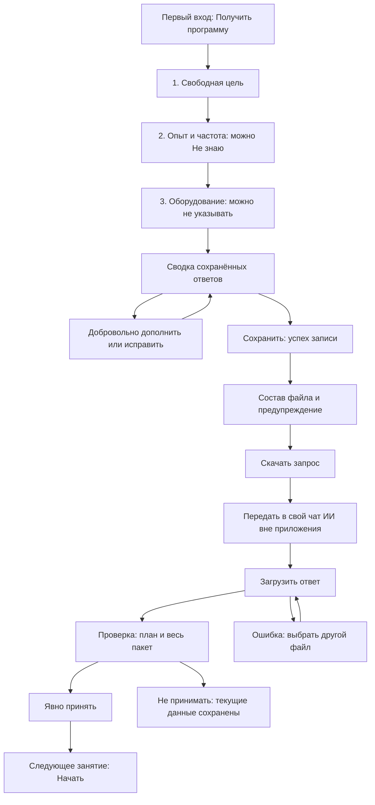

# UX-03 — понятный следующий шаг

Дата исследования: **26 ноября 2026**, Europe/Moscow. Статус: исследование и проект решения для обсуждения; изменения production UI не реализованы и не утверждены этим документом.

## Задача и приёмка

Владелец: «много текста и мало понятного». Нужно спроектировать весь путь, чтобы действие было понятно без чтения инструкции к приложению.

Критерии исследовательского среза:

- Осмотреть текущее приложение, отдельно первый вход и ежедневное выполнение; не записывать пользовательские данные на 4178.
- Сравнить 3–5 релевантных приложений по доступным официальным руководствам, обозначив непроверенное.
- Подготовить структуру экранов, русские действия, интерактивный путь первого плана и задачи реализации с приёмкой.
- Проверить доступную геометрию 360–390 px и увеличенный текст, честно отделить прототип от production и телефона.
- Сохранить local-first, явный внешний обмен, подтверждение пакета, историю, добровольность и безопасные ошибки.

План выполненного среза: документы и код → наблюдение текущих экранов → официальные руководства и UX-практики → проект структуры → кликабельный прототип → проверки и backlog. Файлы: этот отчёт, `design/ux-03/prototype.html`, `design/ux-03/overview.html`, `PROGRESS.md`; временный аудит-сервер в `local-data/ux03-server.mjs`. Production `src`, `app`, схемы и зависимости не изменяются. Git отсутствует; обзор по содержимому файлов, без утверждения о git diff.

## Что наблюдалось сейчас

Обозначения: **Н** — непосредственно увидено в браузере; **К** — подтверждено кодом; **Г** — гипотеза о поведении пользователя, требующая теста.

Основные разделы осмотрены в native Chrome/Windows через CUA. 4178: Тренер, Профиль, Тренировка и Прогресс, только чтение и навигация, без нажатия save/export/accept. Данные не использованы в конкурентном поиске. На отдельном новом origin **127.0.0.1:4185**: первый `/coach` без профиля; затем собственная синтетическая fixture → старт → reload/resume → сохранение одного подхода с неизвестным весом → ручной отдых → частичное завершение → следующее занятие Б. Исходный seed не перезаписывает имеющийся профиль. Запись только на 4185. Просмотр страницы может выполнять существующее обслуживание приложения (например, кеш оболочки); сохранность всех байтов БД 4178 до/после не измерялась.

| Приоритет | Пример из текущего UI | Следствие / предлагаемое исправление |
|---|---|---|
| P0 | **Н:** в первом Тренере заголовок, слоган, ещё заголовок, два объяснения и длинное вступление к форме. На видимой высоте цель только начинается | **Г:** человек ещё не видит, какой объём работы впереди. Сразу вопрос «Какая у вас цель?» и «1 из 3» |
| P0 | **Н/К:** раскрыты возраст, рост, вес, время, четыре текстовых поля, питание и согласие; сохранение внизу. **К:** после глобального onboarding перед первым экспортом нужна новая проверка/запись в Тренере | Один сбор сведений, затем краткая сводка и выборочное изменение. Подробности по желанию |
| P0 | **Н:** обычный сигнал анализа занимает почти весь первый экран тренировки. «Начать тренировку» ниже полного плана и порядка занятий | Показать следующий шаблон и старт раньше обычного анализа. Safety оставить заметным до нагрузки |
| P0 | **Н:** после старта сначала статус, объяснение снимка, блок отдыха и пояснения; текущая форма ниже. Одновременно открыты все незаписанные подходы | Текущий подход первым. Остальные — компактный список с возможностью выбрать любой, без обязательного линейного прохождения |
| P1 | **Н:** в одном подходе три крупные кнопки: сохранить, закрыть, пропустить. «Факт для» и название повторяются. RIR неизвестен присутствует и в плане | Одна основная кнопка «Сохранить подход»; единицы и неизвестный вес рядом с полем; вторичные действия по запросу |
| P1 | **Н:** отдых запускается отдельно у упражнения, отсчёт находится выше формы. После сохранения факта отдых сам не начался | Сохранённый факт и доступный таймер рядом. Автостарт — отдельная продуктовая опция, не скрытая смена поведения |
| P0 | **Н:** Тренер с принятой программой одновременно показывает сигнал, техописание состава/агрегатов, шесть видов замеров, два способа экспорта, импорт и версии | Разделить «Подготовить запрос» и «Загрузить ответ». Состав данных оставить непосредственно перед экспортом |
| P1 | **Н:** частичное завершение объяснено корректно; после него сразу следующий план, итог только коротким статусом | Отдельный компактный итог: сохранено, частичность, что следующее. «К следующему занятию» |
| P1 | **Н:** прогресс начинается с цели и нескольких объяснений статистики; профиль смешивает редактор, backup, storage и полное удаление | Прогресс — сохранённая работа, подробности по запросу. Профиль — сводка с редактированием нужной группы, отдельные разделы хранения |

Положительное сохранить: четыре понятных раздела; предзаполнение; неизвестный вес не превращается в ноль; сохранение факта явное; ошибки не выдают успех; частичность/пропуски различаются; история не заменяется программой. Это аудит интерфейса, не вывод о непонимании у измеренной группы: пользовательских интервью и количественного исследования здесь не было.

## Сравнение: что действительно проверено

Источники — публичные официальные инструкции с конкретными действиями и примерами экранов, а не рекламные обещания. Нативные аккаунты конкурентов не создавались, подписки не покупались; актуальность каждого экрана на iOS/Android вручную не подтверждена. Изображения по ссылкам найдены, но их пиксельный дизайн не использован как отдельное доказательство. Возраст инструкции Strong (2021–2022) существенно ограничивает вывод о нынешнем внешнем виде.

| Сценарий | Fitbod | Hevy | Strong |
|---|---|---|---|
| Первый вход | F1: вопросы об опыте, цели, оборудовании; пропущенный опыт можно задать позже | Полная анкета первого запуска не проверена | Полная анкета первого запуска не проверена |
| Профиль/настройки | F2: My Plan — цель, оборудование, частота; остальное имеет defaults | H1: настройки тренировок вынесены в Profile → Settings | S2: настройки таймера отдельно |
| Получение плана | F2: настройки влияют на построение плана | H2: reusable routine создаётся отдельно от workout | S1: template отдельно от фактического занятия |
| Старт | F3: из workout можно открыть упражнение | H2: Workout → Start routine | S3: Empty Workout или Template |
| Ввод подхода | F3: редактирование reps/weight внутри упражнения | H1: поля нагрузки/повторов, отметка выполнения | S3: ввести вес/повторы, отметить checkbox |
| Отдых | F3: у названия упражнения | H1: автоматический после отметки | S2: после подхода, раскрывается по нажатию |
| Завершение | Не проверено по выбранным источникам | H1: Finish → просмотр итогов → сохранение | S3: Finish; допустимо закончить до всех упражнений |
| Прогресс | F3: история доступна из упражнения | H1: прошлые значения при записи, итог после занятия | S3: выполненное доступно в History |
| Обновление | F1: автоматическая адаптация; F2: изменение цели без потери progress | H3: выбор обновить структуру или оставить исходную; вес/повторы имеют отдельное поведение | S4: Update Template / Keep Original, варианты обновления значений |

Официальные материалы:

- **F1:** [Getting Started with Fitbod](https://help.fitbod.me/hc/en-us/articles/30721771750039-Getting-Started-with-Fitbod-A-New-User-s-Guide), обновлён 16.04.2026.
- **F2:** [My Plan](https://help.fitbod.me/hc/en-us/articles/34336407191191-My-Plan), обновлён 09.09.2026.
- **F3:** [Exercise Details Screen](https://help.fitbod.me/hc/en-us/articles/30721437384215-How-to-Navigate-the-Exercise-Details-Screen), обновлён 16.04.2026.
- **H1:** [Log & Track Workouts](https://www.hevyapp.com/features/track-workouts/), разделы 1–8 с последовательностью действий.
- **H2:** [Workouts vs Routines](https://help.hevyapp.com/hc/en-us/articles/33703513582871-Workouts-vs-Routines-in-Hevy-What-They-Mean-and-How-to-Use-Them).
- **H3:** [Update Routine vs Keep Original](https://help.hevyapp.com/hc/en-us/articles/38387296276375-Update-Routine-vs-Keep-Original-Routine).
- **S1:** [Templates](https://help.strongapp.io/article/105-about-templates), 20.05.2021.
- **S2:** [Rest Timer](https://help.strongapp.io/article/231-rest-timer), 08.02.2021.
- **S3:** [Perform a workout](https://help.strongapp.io/article/229-my-first-workout), 14.02.2022.
- **S4:** [Update a Template](https://help.strongapp.io/article/177-update-template-or-routine), 26.05.2021.

**Наш вывод, не утверждение источников:** заимствовать разделение настройки и выполнения, явное отличие плана от факта и контекстные подробности. Не переносить автоматическое изменение плана Fitbod/значений Hevy: у нас требуется принятие полного пакета. Не переносить соцсеть, аккаунт, платный Coach, облако, ссылки из пользовательских заметок или сторонние видео. У нас внешний JSON-обмен — реальный дополнительный переход, его нужно показать честно, а не обещать мгновенную генерацию внутри приложения.

## Практики и их применение

| Источник | Проверенная рекомендация | Решение UX-03 — наша гипотеза |
|---|---|---|
| [NN/g: Progressive Disclosure](https://www.nngroup.com/articles/progressive-disclosure/) | Редкие/сложные возможности показывать по запросу; основной экран задаёт приоритет внимания | Убрать версии, состав агрегатов и редкие настройки из ежедневного пути. Не прятать важные последствия операции |
| [GOV.UK: Question pages](https://design-system.service.gov.uk/patterns/question-pages/) | Заголовок относится к текущему вопросу; подсказки короткие. Длинный hint особенно мешает диктору | Три шага с конкретными вопросами. Опыт и частоту объединить как связанную пару; проверить это объединение на пользователях |
| [GOV.UK: Button](https://design-system.service.gov.uk/components/button/) | Текст описывает действие; несколько главных кнопок затрудняют выбор | «Сохранить и подготовить запрос», «Загрузить ответ ИИ», «Принять программу»; скачать и копировать не равноправные CTA |
| [GOV.UK: Error message](https://design-system.service.gov.uk/components/error-message/) | Объяснить проблему и способ исправить | Ошибка у поля + summary/focus; сохранный ввод; повтор действия, без ложной отметки «готово» |
| [W3C: Resize Text](https://www.w3.org/WAI/WCAG22/Understanding/resize-text.html), [Reflow](https://www.w3.org/WAI/WCAG22/Understanding/reflow.html) | Увеличение до 200% без потери; reflow при эквиваленте 320 CSS px | Не фиксировать высоту текстовых блоков, не закрывать контент нижним меню. Наши 360/390 проверки не означают WCAG-сертификацию |

Нет основания обещать, что сокращение текста само повысит удержание. Проверяем, может ли человек назвать и выполнить следующий шаг. Время до результата включает внешний чат и не может считаться только временем в анкете.

## Предлагаемая структура и переходы

Четыре вкладки сохранить: **Тренировка / Прогресс / Тренер / Профиль**. Начальная настройка — последовательность внутри текущего сценария, без пятой вкладки и новой регистрации.

Если профиль уже есть — сразу сводка E, ответы не спрашивать заново. Возврат из редактирования сохраняет введённое, не сбрасывает шаги. Если ответ уже получен — импорт доступен отдельно, без повторной анкеты; актуальность всё равно проверяет существующий контракт. Ошибка чтения БД не считается первым входом. После reload состояние восстанавливается из сохранённых profile/request/preview/session; никакой второй изменяемой модели БД в React.

| Экран/состояние | Что видно прежде всего | Основное действие | По запросу / отдельно |
|---|---|---|---|
| Без профиля/плана | Что получится и что понадобится внешний чат | Получить программу | Уже есть ответ; восстановление backup |
| Цель | Один вопрос, свободный ответ и подсказки | Дальше | Не ограничивать цель набором chips |
| Опыт и ритм | Два коротких вопроса с «Не знаю» | Дальше | Пояснение уровня при выборе |
| Оборудование | Существующие 9 вариантов, без выдуманных presets | Проверить сведения | Не знаю = без отметок |
| Сводка | Известные ответы, изменение нужного блока | Сохранить и подготовить запрос | Все существующие optional, без новых обязательных полей |
| Подготовка запроса | Конкретный состав, личные сведения, отсутствие фото, отсутствие автоотправки | Скачать запрос | Копировать весь запрос; добровольные замеры с явным выбором |
| После скачивания | Прикрепить к своему чату → вернуть JSON | Загрузить ответ ИИ | Скопировать короткую команду, повторить скачивание. Не говорить «файл сохранён» без гарантии |
| Preview | Интерпретация цели, последовательность, краткое резюме, предупреждения | Принять программу | Полный пакет/весь план доступны; чекбокс подтверждения; не принимать |
| Главная с планом | Следующее А/Б, краткое число упражнений/подходов | Начать тренировку | План, очередь; обычный анализ ниже старта |
| Незавершённая | Название и сохранённые факты | Продолжить тренировку | Без обязательного повторного обзора плана |
| Выполнение | Текущие упражнение/подход, план и редактируемый факт с единицами | Сохранить подход | Запас повторений, исправить любой сохранённый, выбрать другое упражнение/пропуск |
| Отдых | Отсчёт рядом с последним сохранённым подходом | Продолжить тренировку | Изменить/убрать таймер; без обещаний фонового звука |
| Завершение | Сколько записано, частичность, следующая позиция | Завершить / завершить частично | Вернуться; без фактов — явно очередь не сдвигается |
| Итог | Сохранённые факты и что следующее | К следующему занятию | Самочувствие по желанию, прогресс |
| Прогресс | Фактические занятия и сопоставимые показатели; без пустых обязательных графиков | К тренировке (пусто) / история (есть данные) | Метод расчёта, добровольные фото/замеры |
| Обновление | Краткое «что/почему», вычисленное Было → Станет | Принять изменения | Весь пакет, не применять; keep: «Принять анализ без изменения плана» |
| Профиль | Сводка и изменение нужного блока | Изменить сведения | Резервная копия; хранение; опасные действия — отдельный путь |

Перед review-экспортом видимый состав обязательно расширяется: активная программа, до20 completed/partial с планом и фактами, весами, добровольными RIR/болью/заметками/заменами; агрегаты истории, причины анализа и заполненный профиль. Отдельный выбор замеров — только выбранные виды за90дней. Фото/контакты исключены. Подробная формула агрегатов раскрывается, но чувствительные категории не прячутся. Во время активного занятия недоступность review объясняется коротко: «Завершите тренировку, чтобы включить её результаты».

## Что убрать с основного экрана

- Слоганы «Сохранённая цель. Осознанный выбор», технические eyebrow и повтор названия упражнения: заменить конкретным состоянием.
- Историю версий — в «Тренер → Программа → Версии». Возврат со всеми последствиями показывать перед подтверждением.
- «Предзаполнение — из плана…» — один раз в первом вводе/по значку пояснения. Метка «План» и «Факт» остаётся.
- Объяснение snapshot, ревизий, агрегатов — в подробности, без UUID в повседневном UI.
- Backup/persistence/удаление — отдельные раскрытия Профиля. Краткое предупреждение о локальном хранении и необходимости копии остаётся доступным; перед restore/erase полный состав и последствия всегда видимы.
- Синтетическое демо — убрать из production-навигации при реализации, сохранить разработческий прототип отдельно.

Нельзя скрывать safety, отказ сохранения, неизвестность веса/единицы (включая помощь тренажёра и одну гантель), состав экспорта, последствия restore/erase, reset очереди при принятии версии и сохранение истории. Не заменять всё это одним общим «Подробнее».

## Конфликты, которые нужно разрешить явно

1. **PRODUCT и UX_GUIDELINES UX-01/02:** раскрывать optional сразу и проверять/пересохранять полную анкету в Тренере при каждом посещении до первого плана. **Предложение:** три коротких шага один раз; существующий профиль — сводка, изменение точечно, проверка актуальности перед экспортом сохраняется. Это меняет утверждённый сценарий; документы не переписаны молча. Альтернатива без изменения правила — сгруппировать всю раскрытую форму и поднять кнопку сохранения, но перегрузка останется. Рекомендуется первый вариант.
2. **Обычный analysis сейчас над занятием:** перенести после старта, но safety оставить перед соответствующей нагрузкой. Не превращать анализ в блокировку тренировок.
3. **Ручной таймер:** в прототипе сохранение показывает состояние отдыха как гипотезу удобства. Production автостарт требует отдельного решения/приёмки атомарности, отказа таймера и гонок; простой первый срез — ручная кнопка рядом с сохранённым фактом. Нельзя незаметно менять существующее правило записи таймера.
4. **Закреплённое нижнее меню утверждено:** прототип в разговоре имеет обычную прокрутку и меню после содержимого; это ограничение макета, не предложение отменить app-shell100dvh/safe-area. Production сохранить собственную строку меню, протестировать клавиатуру и крупный текст. Два столбца кнопок макета не являются утверждением новой production-компоновки навигации.

## Прототип и граница проверки

`design/ux-03/prototype.html`: 18 выбираемых состояний, включая полный основной путь, optional, отказ импорта, отказ записи, обновление, прогресс/профиль. Синтетические данные, никакой БД, файлового импорта, download, clipboard, HTTP, трекеров или AI. Соответствующие кнопки явно демонстрируют переход, не реальный успех операции. Ввод живёт только в текущем макете; в состояние разговора сохраняется только выбранный экран, без ответов/весов. Синтетический план не является тренировочной рекомендацией. Полные needs_input/unsupported/restore/erase/version-rollback и реальная запись — специфицированы задачами ниже, не реализованы этим макетом.

`design/ux-03/overview.html`: обзор ключевых экранов вместе; это схема интерфейса, не скриншоты production или конкурентов.

Проверено CUA в native Chrome: путь 0→1→2→3→4→5→6→7→8→9, пустая цель → ошибка/фокус; unknown опыт/частота, выбранные гантели; явный checkbox перед принятием; поле веса12 → пример отказа → повтор → отдых. Проверены контейнеры макета **390px/16px**, **360px/16px**, **360px/32px**: видимые заголовки/поля/кнопки переносятся, доступны вертикальной прокруткой. На200% осмотрены цель, экспорт, отдых и ввод подхода, не все18состояний. После первого осмотра уменьшен относительный размер h1 для длинных русских слов, grid полей переведён в em. Финальный повтор подтвердил перенос заголовка экспорта по словам и одну колонку полей веса/повторов при360px/32px. Обзор6экранов осмотрен при desktop-ширине; самостоятельный тёмный wrapper не задавал color-scheme, поэтому подписи вне экранов были слишком тёмными. В финальном overview цвет подписей задан явно светлым для тёмного макета; отдельная повторная native проверка этой единственной цветовой правки не выполнялась.

Граница: ширина задана CSS-контейнером макета внутри desktop-окна1041px. Это не измерение viewport360, не браузерный zoom200%, не200% OS, не доказательство адаптивности production. Для320px есть режим, но ручная приёмка не проведена. Нет аудита всех таб-переходов, диктора, touch/телефона, виртуальной клавиатуры, контраста всех состояний или независимого usability-теста. Общее T14 и M6/M7 остаются открытыми.

## Задачи реализации по приоритету

Оценки времени намеренно не заменяют критерии. Выполнять вертикальными срезами, без DB-миграции ради навигации и без общего переписывания приложения.

| ID | Приоритет / срез | Файлы-кандидаты | Проверяемая приёмка |
|---|---|---|---|
| UX-04 | P0: единый короткий сбор сведений | edit-profile/editor,onboarding,model; coach-content/exchange; PRODUCT,UX_GUIDELINES | После явного выбора сценария: новый профиль без optional проходит3шага, возврат не теряет ввод; сохранённый профиль сразу сводкой; экспорт после commit и сверки актуальности; reload/две вкладки/writefailure; ни одного нового обязательного поля |
| UX-05 | P0: обмен как состояния | coach-exchange,coach-preview,program-diff; coach view | Первый/review export→инструкция→import→preview→accept; прямой import остаётся; все чувствительные категории видны перед экспортом; download denial не считается сохранением; stale/malformed/needs_input/unsupported не меняют программу; полный пакет и отличия доступны; подтверждение атомарно |
| UX-06 | P0: быстрый старт и один текущий ввод | next-workout,set-form,session-controls; analysis-signal; workout view | Старт/resume≤2нажатий без прокрутки обычного анализа при360×800/16px; подтверждение неизменного подхода1нажатие; другие упражнения доступны без принуждения; безопасное сохранение/исправление/CAS/таймер/reload; safety не скрыт |
| UX-07 | P1: короткий итог, прогресс, редактирование по группе | training-progress,body-progress,profile view/editor,backup/privacy | Итог показывает completed/partial/безфактов и верную очередь; история неизменна; пустой прогресс без обязательных графиков; редактирование одной группы сохраняет остальные; backup/restore/erase по-прежнему с полноценными последствиями |
| UX-08 | P1: доступность нового пути | app-shell,shared/ui,globals.css и затронутые features | Все новые состояния360/390 и320CSSpx,200%текст/zoom; таб/Enter/Space,focus после перехода/ошибки; диктор; safe-area/клавиатура; target≥44px; контраст; длинные русские названия и разные единицы |
| UX-09 | P1: проверка понимания | TESTING; отдельный обезличенный протокол | 5 добровольцев, включая новичков: без подсказок найти следующий шаг, пройти первый цикл и записать/исправить подход. Цель≥4/5 без помощи; медиана анкеты≤90с без внешнего ИИ; отдельно время/ошибки обмена и причины остановок. Это целевые пороги, не полученные результаты. Без трекеров и автоматической отправки данных |

Проверки проекта: lint/typecheck успешны;499/499Vitest+6/6NodePWA; build успешен,48ресурсов, shell9b9170d5d092cfd6bec7894f; HTTP7/7. Первые test/build/routes встретили sandbox spawnEPERM; разрешённые повторы вне sandbox прошли, auto-review отказов не было. Эти регрессии не доказывают качество UX и не покрывают HTML-макет; его JS дополнительно проверен `node local-data/ux03-check.mjs`, взаимодействия — вручную выше. При правке динамического текста завершения syntax-check обнаружил неверную вложенную интерполяцию; исправлено до финального browser-повтора, итоговый syntax-check успешен. Новые business/unit-тесты не добавлялись: production-логика не менялась. После сборки менялись только документы/изолированный макет. Временный4185 остановлен; существующие4174/4178 не останавливались. Вкладка аудита закрыта. Синтетическая БД4185 не удалялась и не смешивалась с4178.

Первый следующий шаг: выбрать предложенный сценарий UX-04 и явно обновить конфликтующие пункты PRODUCT/UX_GUIDELINES в его реализации. До этого UX-01/02 остаются действующим production-поведением. M6/M7 и внешний AI/methodology review этим исследованием не закрываются.
